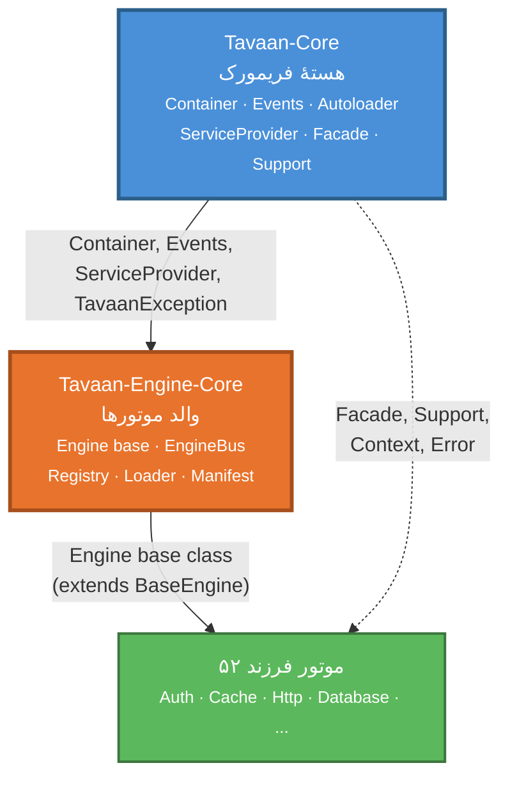
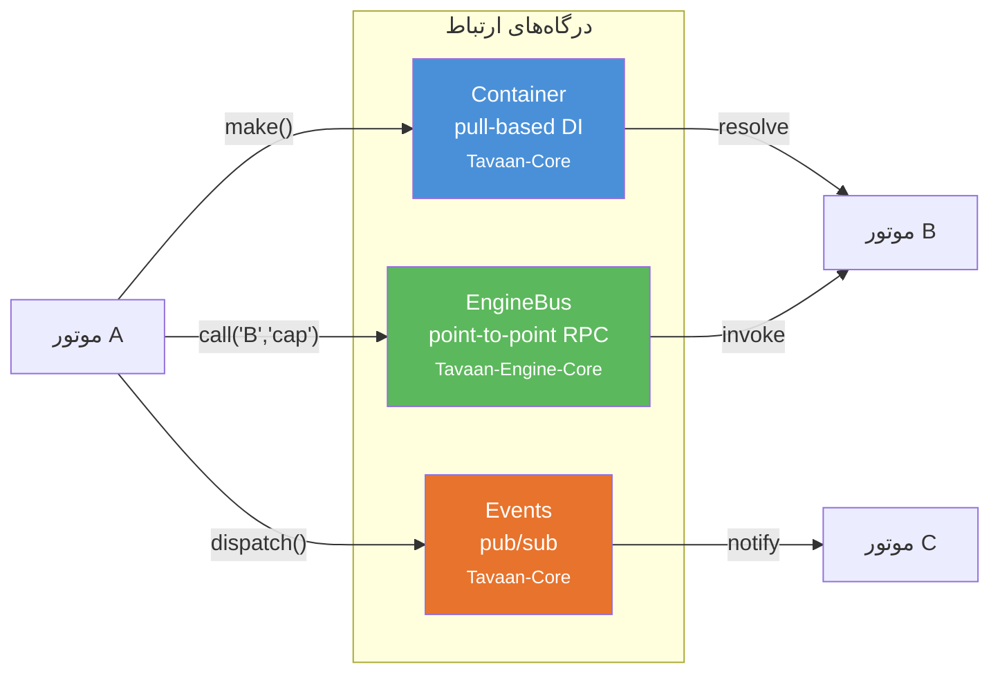

# نمودار وابستگی موتورهای تَوان

> این نمودار وابستگی‌های کامل ۵۲ موتور تَوان و ۲ مخزن مرکزی را نشان می‌دهد.

## ۱. معماری کلی

## ۲. سه درگاه ارتباط بین موتورها

## ۳. لایه‌بندی موتورها بر اساس وابستگی

```mermaid
graph TD
    subgraph L0["لایهٔ ۰ — پایه (بدون وابستگی)"]
        container["container"]
        compat["compat"]
        test["test"]
    end

    subgraph L1["لایهٔ ۱"]
        config["config"]
        pipeline["pipeline"]
    end

    subgraph L2["لایهٔ ۲"]
        event["event"]
        crypt["crypt"]
        hash["hash"]
        filesystem["filesystem"]
        i18n["i18n"]
        log["log"]
        cache["cache"]
        feature_flag["feature-flag"]
        media["media"]
        payment["payment"]
        search["search"]
        tenancy["tenancy"]
        console["console"]
        module["module"]
    end

    subgraph L3["لایهٔ ۳"]
        database["database"]
        error["error"]
        http["http"]
        http_client["http-client"]
        mail["mail"]
        notification["notification"]
        queue["queue"]
        view["view"]
        validation["validation"]
        jalali["jalali"]
        optimizer["optimizer"]
        observability["observability"]
        backup["backup"]
    end

    subgraph L4["لایهٔ ۴"]
        orm["orm"]
        schema["schema"]
        cookie["cookie"]
        cors["cors"]
        session["session"]
        router["router"]
        migration["migration"]
        scaffold["scaffold"]
        schedule["schedule"]
        upgrade["upgrade"]
        audit["audit"]
        plugin["plugin"]
        report["report"]
    end

    subgraph L5["لایهٔ ۵"]
        auth["auth"]
        rbac["rbac"]
        realtime["realtime"]
        security["security"]
    end

    subgraph L6["لایهٔ ۶ — کاربرد"]
        admin["admin"]
        api["api"]
        workflow["workflow"]
    end

    %% L0 → L1
    container --> config
    container --> pipeline

    %% L1 → L2
    config --> event
    config --> crypt
    config --> hash
    config --> filesystem
    config --> i18n
    config --> log
    config --> feature_flag
    config --> media
    config --> payment
    config --> search
    config --> tenancy
    config --> console
    config --> module
    event --> cache

    %% L2 → L3
    config --> database
    event --> database
    log --> database
    config --> error
    log --> error
    pipeline --> http
    event --> http
    error --> http
    config --> http
    config --> http_client
    event --> http_client
    config --> mail
    event --> mail
    config --> notification
    event --> notification
    config --> queue
    event --> queue
    event --> view
    i18n --> view
    config --> view
    i18n --> validation
    config --> validation
    i18n --> jalali
    config --> optimizer
    console --> optimizer
    config --> observability
    log --> observability
    config --> backup
    filesystem --> backup

    %% L3 → L4
    database --> orm
    event --> orm
    database --> schema
    http --> cookie
    crypt --> cookie
    http --> cors
    config --> cors
    http --> session
    crypt --> session
    config --> session
    http --> router
    container --> router
    config --> router
    database --> migration
    schema --> migration
    console --> migration
    console --> scaffold
    filesystem --> scaffold
    config --> schedule
    console --> schedule
    console --> upgrade
    database --> upgrade
    filesystem --> upgrade
    event --> audit
    log --> audit
    crypt --> audit
    config --> audit
    module --> plugin
    filesystem --> plugin
    crypt --> plugin
    config --> report

    %% L4 → L5
    session --> auth
    hash --> auth
    crypt --> auth
    event --> auth
    database --> auth
    cache --> auth
    config --> auth
    auth --> rbac
    database --> rbac
    cache --> rbac
    event --> rbac
    config --> rbac
    config --> realtime
    event --> realtime
    http --> realtime
    http --> security
    crypt --> security
    cache --> security
    config --> security

    %% L5 → L6
    view --> admin
    rbac --> admin
    orm --> admin
    validation --> admin
    http --> admin
    config --> api
    http --> api
    config --> workflow

    style L0 fill:#f0f8ff,stroke:#4a90d9
    style L1 fill:#e6f3ff,stroke:#4a90d9
    style L2 fill:#fff8e6,stroke:#e8a200
    style L3 fill:#fff0e6,stroke:#e8732c
    style L4 fill:#ffe6f0,stroke:#d949a0
    style L5 fill:#f0e6ff,stroke:#8a49d9
    style L6 fill:#e6ffe6,stroke:#5cb85c
```

## ۴. وابستگی‌های مفصل هر موتور

```mermaid
graph TD
    %% Base
    container(("container"))
    compat(("compat"))
    test(("test"))

    %% Level 1
    config["config<br/><small>پیکربندی</small>"]
    pipeline["pipeline<br/><small>میان‌افزار</small>"]

    %% Level 2 — Config deps
    crypt["crypt<br/><small>رمزنگاری</small>"]
    hash["hash<br/><small>هش</small>"]
    filesystem["filesystem<br/><small>فایل</small>"]
    i18n["i18n<br/><small>زبان</small>"]
    log["log<br/><small>لاگ</small>"]
    feature_flag["feature-flag<br/><small>پرچم ویژگی</small>"]
    media["media<br/><small>رسانه</small>"]
    payment["payment<br/><small>پرداخت</small>"]
    search["search<br/><small>جست‌وجو</small>"]
    tenancy["tenancy<br/><small>مستاجر</small>"]
    report["report<br/><small>گزارش</small>"]

    %% Level 2 — Event deps
    cache["cache<br/><small>کش</small>"]
    event["event<br/><small>رویداد</small>"]

    %% Level 2 — Container deps
    console["console<br/><small>CLI</small>"]
    module["module<br/><small>ماژول</small>"]

    %% Level 3
    database["database<br/><small>دیتابیس</small>"]
    error["error<br/><small>خطا</small>"]
    http["http<br/><small>HTTP</small>"]
    http_client["http-client<br/><small>HTTP Client</small>"]
    mail["mail<br/><small>ایمیل</small>"]
    notification["notification<br/><small>اعلان</small>"]
    queue["queue<br/><small>صف</small>"]
    view["view<br/><small>ویو</small>"]
    validation["validation<br/><small>اعتبارسنجی</small>"]
    jalali["jalali<br/><small>جلالی</small>"]
    optimizer["optimizer<br/><small>بهینه‌ساز</small>"]
    observability["observability<br/><small>مشاهده‌پذیری</small>"]
    backup["backup<br/><small>پشتیبان</small>"]

    %% Level 4
    orm["orm<br/><small>ORM</small>"]
    schema["schema<br/><small>Schema</small>"]
    cookie["cookie<br/><small>کوکی</small>"]
    cors["cors<br/><small>CORS</small>"]
    session["session<br/><small>نشست</small>"]
    router["router<br/><small>مسیریاب</small>"]
    migration["migration<br/><small>مهاجرت</small>"]
    scaffold["scaffold<br/><small>داربست</small>"]
    schedule["schedule<br/><small>زمان‌بند</small>"]
    upgrade["upgrade<br/><small>ارتقا</small>"]
    audit["audit<br/><small>حسابرسی</small>"]
    plugin["plugin<br/><small>پلاگین</small>"]

    %% Level 5
    auth["auth<br/><small>احراز هویت</small>"]
    rbac["rbac<br/><small>RBAC</small>"]
    realtime["realtime<br/><small>بلادرنگ</small>"]
    security["security<br/><small>امنیت</small>"]

    %% Level 6
    admin["admin<br/><small>پنل مدیریت</small>"]
    api["api<br/><small>API</small>"]
    workflow["workflow<br/><small>گردش کار</small>"]

    %% Dependencies
    container --> config
    container --> pipeline
    container --> event
    config --> crypt
    config --> hash
    config --> filesystem
    config --> i18n
    config --> log
    config --> feature_flag
    config --> media
    config --> payment
    config --> search
    config --> tenancy
    config --> report
    event --> cache
    config --> console
    config --> module

    config --> database
    event --> database
    log --> database
    config --> error
    log --> error
    pipeline --> http
    event --> http
    error --> http
    config --> http
    config --> http_client
    event --> http_client
    config --> mail
    event --> mail
    config --> notification
    event --> notification
    config --> queue
    event --> queue
    event --> view
    i18n --> view
    i18n --> validation
    i18n --> jalali
    config --> optimizer
    console --> optimizer
    config --> observability
    log --> observability
    config --> backup
    filesystem --> backup

    database --> orm
    event --> orm
    database --> schema
    http --> cookie
    crypt --> cookie
    http --> cors
    http --> session
    crypt --> session
    http --> router
    database --> migration
    schema --> migration
    console --> migration
    console --> scaffold
    filesystem --> scaffold
    config --> schedule
    console --> schedule
    console --> upgrade
    database --> upgrade
    filesystem --> upgrade
    event --> audit
    log --> audit
    crypt --> audit
    module --> plugin
    filesystem --> plugin
    crypt --> plugin

    session --> auth
    hash --> auth
    crypt --> auth
    event --> auth
    database --> auth
    cache --> auth
    auth --> rbac
    database --> rbac
    cache --> rbac
    event --> rbac
    config --> realtime
    event --> realtime
    http --> realtime
    http --> security
    crypt --> security
    cache --> security

    view --> admin
    rbac --> admin
    orm --> admin
    validation --> admin
    http --> admin
    config --> api
    http --> api
    config --> workflow

    style container fill:#4a90d9,color:#fff
    style config fill:#4a90d9,color:#fff
    style event fill:#4a90d9,color:#fff
    style database fill:#e8732c,color:#fff
    style http fill:#e8732c,color:#fff
    style auth fill:#d949a0,color:#fff
    style admin fill:#5cb85c,color:#fff
    style api fill:#5cb85c,color:#fff
    style workflow fill:#5cb85c,color:#fff
```

## ۵. جدول وابستگی‌های کامل

| موتور | وابستگی‌های اجباری | وابستگی‌های اختیاری |
|---|---|---|
| **container** | — | — |
| **compat** | — | — |
| **test** | — | — |
| **config** | container | — |
| **pipeline** | container | — |
| **event** | container, config | — |
| **crypt** | config | — |
| **hash** | config | — |
| **filesystem** | config | — |
| **i18n** | config | — |
| **log** | config | — |
| **cache** | config, event | — |
| **feature-flag** | config | cache, database, rbac, tenancy |
| **media** | config | — |
| **payment** | config | http-client, database, migration, orm, event, crypt, http, console |
| **search** | config | — |
| **tenancy** | config | — |
| **report** | config | database, filesystem, view, i18n, compat, http |
| **console** | container, config | — |
| **module** | container, config | — |
| **database** | config, event, log | — |
| **error** | config, log | — |
| **http** | pipeline, event, error, config | — |
| **http-client** | config, event | — |
| **mail** | config, event | — |
| **notification** | config, event | — |
| **queue** | config, event | database, cache, log |
| **view** | event, i18n, config | — |
| **validation** | i18n, config | — |
| **jalali** | i18n | — |
| **optimizer** | config, console | — |
| **observability** | config, log | — |
| **backup** | config, filesystem | database, crypt, cache, compat |
| **orm** | database, event | — |
| **schema** | database | — |
| **cookie** | http, crypt | — |
| **cors** | http, config | — |
| **session** | http, crypt, config | database, cache |
| **router** | http, container, config | — |
| **migration** | database, schema, console | — |
| **scaffold** | console, filesystem | — |
| **schedule** | config, console | cache, queue, log |
| **upgrade** | console, database, filesystem | — |
| **audit** | event, log, crypt, config | — |
| **plugin** | module, filesystem, crypt | — |
| **auth** | session, hash, crypt, event, database, cache, config | http, orm, notification |
| **rbac** | auth, database, cache, event, config | — |
| **realtime** | config, event, http | database, cache, queue, auth |
| **security** | http, crypt, cache, config | session, router |
| **admin** | view, rbac, orm, validation, http | — |
| **api** | config, http | validation, orm, cache, router |
| **workflow** | config | event, database, migration, rbac, queue, console, auth |

## ۶. زنجیرهٔ وابستگی بلندترین

> **admin** با ۷ سطح وابستگی، عمیق‌ترین موتور است:
> `container → config → log → database → orm → rbac → admin`
